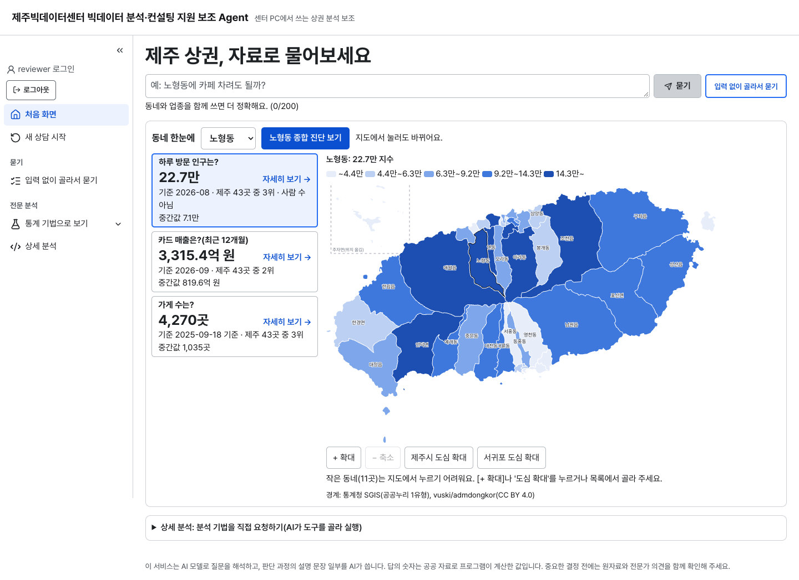
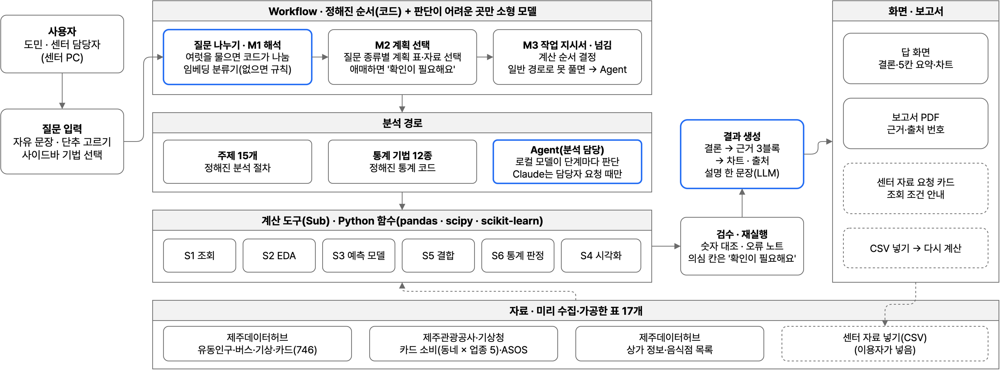

# 제주빅데이터센터 빅데이터 분석·컨설팅 지원 보조 Agent

제주 43개 읍면동의 상가·음식점·유동인구·버스·카드 매출·기상 자료로 상권 질문에 답하는 AI Agent이다. 센터를 찾은 소상공인·예비창업자와 센터 담당자가 쓴다.
질문을 해석해 볼 자료와 분석 방법을 정하고, 계산과 검수를 거쳐 답 카드로 보여 준다. 답마다 근거 데이터, 기준 시점, 한계를 함께 보여 준다.

**웹 데모(참고용)**: https://jeju-agent-junhees-projects-5f5f2302.vercel.app — 2026-11-14 판이며 이후 갱신하지 않는다. 로컬 모델이 없어 기능이 줄어든 판이므로, 제출본 동작은 아래 '빠른 실행'과 시연 영상으로 확인한다 · **기획서(PDF)**: [11/16 채움] · **시연 영상**: [11/16 채움] · **결과 설명자료**: [`docs/제출/결과_설명자료.md`](docs/제출/결과_설명자료.md)

## 빠른 실행
| 순서 | Windows(센터 PC) | macOS |
|---|---|---|
| 1. 설치(처음 1회, 인터넷 필요) | `scripts\setup_windows.bat` | `sh scripts/setup_mac.sh` |
| 2. 실행 | `scripts\run_windows.bat` | `sh scripts/run_mac.sh` |
| 3. 접속 | 실행하면 기록을 남기지 않는 브라우저 창(Edge InPrivate, 없으면 Chrome 시크릿)이 http://localhost:8501 로 열린다 | 같음(Chrome 시크릿, 없으면 Edge InPrivate) |
| 4. 방문자가 바뀔 때 | 브라우저 창을 닫고 `scripts\run_windows.bat`을 다시 실행한다(서버는 그대로 쓰고 새 창만 연다) | 창을 닫고 `sh scripts/run_mac.sh`를 다시 실행 |

필요 환경: Python 3.9. 표준 테이블(`data/tables/`)이 들어 있어 데이터를 내려받지 않아도 바로 동작한다.

권장: 설치 전에 [Ollama](https://ollama.com/download)를 설치한다. 설치 스크립트가 Ollama를 찾으면 로컬 모델 3개를 함께 받는다. `bge-m3`(질문 해석, 1.2GB), `qwen3:1.7b`(설명 문장, 1.4GB), `qwen2.5:7b`(Agent 도구 선택, 4.7GB)이다. 실행 스크립트는 시작할 때 어느 경로로 도는지 실행 창에 알려 준다.

**앱 실행에는 API 키가 필요 없다.** 기본은 로컬 소형 모델과 코드 규칙으로 돈다. Claude는 센터 담당자가 로그인한 뒤 전문가 모드에서 [Claude로 분석]을 누른 요청에만 쓴다. 이때만 아래 [Claude 키 설정](#claude-키-설정선택)을 따른다.

## 기획 설명

### 문제
- 제주테크노파크는 센터·데이터허브 데이터로 시각화 분석과 데이터 활용 컨설팅을 지원한다(공고 제2026-116호). 2026년 1차 모집은 선착순 10건 내외이고, 2025년 실적은 컨설팅 7건, 분석 5건이다(보도자료 2026-04-28).
- 2020~2024년 지원 과제 53건에는 '신규 매장 입지 조사를 위한 유동인구 시각화 분석' 같은 상권 분석이 포함됐다(보도자료 2025-04-30).

| 단계 | 현재 | 이 Agent로 바꾸는 것(제안) |
|---|---|---|
| 신청 | 선착순 10건 내외라 신청하지 못한 도민은 분석 지원을 받지 못함 | 신청 없이도 센터 PC에서 동네 상권 자료와 보고서(PDF)를 직접 확인 |
| 사전 면담 | 신청자 모두와 담당자가 면담 | 도민이 Agent 결과를 먼저 확인하고, 해결되지 않는 요청만 면담 |
| 분석·컨설팅 | 담당자가 요청마다 분석을 직접 수행 | 담당자는 Agent 보고서를 면담 자료로 쓰고, 추가 분석은 통계 기법 12종·전문가 모드로 실행 |
| 결과 송부 | 2주 이내 | 질문 직후 답 화면과 보고서 PDF |

### 사용자와 Use Case
1차 사용자는 센터를 찾은 소상공인·예비창업자(도민), 2차 사용자는 센터 담당자이다. Agent는 창업 여부를 추천하거나 결정하지 않고, 판단에 쓸 근거(숫자·순위·출처·한계)를 보여 준다.

| Use Case | 사용자 | 질문 예 | 받는 결과 |
|---|---|---|---|
| 1. 동네 종합 분석 | 예비창업자 | 노형동에 카페 차려도 될까? | 결론 한 줄, 5칸 요약(방문·카드 매출·가게 수·생존율·앞으로의 변화), 자료 한계 안내, 보고서 PDF |
| 2. 두 동네 비교 | 소상공인 | 노형동과 연동 카페 비교 | 11개 지표 비교(같은 주·같은 달끼리 짝 검정), 출처 번호가 붙은 보고서 PDF |
| 3. 통계 기법으로 분석 | 센터 담당자 | 43개 동네 방문과 매출의 상관 분석해줘 | 기법 12종 중 선택, 적용 조건이 맞지 않으면 계산 대신 이유 표시 |
| 4. 전문가 모드 | 센터 담당자 | 하려는 분석을 문장으로 요청 | 로컬 모델이 기법 12종 중에서 골라 실행. 목록에 없는 분석은 담당자가 [Claude로 분석]을 눌러 Claude가 코드를 작성하고, 검사 뒤 분리된 프로세스에서 실행 |

### Agent 구조

구조를 한 줄로 쓰면 '정해진 순서의 Workflow에, 판단이 어려운 곳에만 소형 모델 Agent가 끼어드는 구조'이다. 질문을 먼저 나눠 소형 모델과 코드 규칙이 감당할 크기로 만들고, Claude는 센터 담당자가 필요할 때만 켠다. 숫자는 모든 경로에서 Python 코드가 계산한다.

| 단계 | 하는 일 | 맡는 쪽 |
|---|---|---|
| 질문 나누기 | 한 질문에 묻는 것이 여럿이면 하위 질문으로 나누고, 앞 조각의 동네·업종과 앞 결과('1위 동네')를 뒤 조각에 넘긴다 | 코드(규칙) |
| M1 질의 해석 | 질문 종류·동네·업종·지표를 읽는다 | 임베딩 분류기(bge-m3 + 로지스틱 회귀), 없으면 사전 규칙 |
| M2 계획 선택 | 질문 종류별 계획 표로 자료와 계산 순서를 정한다. 해석이 애매하면(확신도 낮음, 분류기·규칙 불일치) 이해 카드에 '확인이 필요해요'로 표시한다 | 코드(`JEJU_CLAUDE=auto`면 Claude가 정해진 종류 13개 중에서 고름) |
| M3 작업 지시서·넘김 | 계산 순서를 확정한다. 일반 경로가 풀지 못한 질문(계산 실패, 분류기만 범위 밖으로 본 질문)은 Agent에게 넘긴다 | 코드(`JEJU_CLAUDE=auto`면 Claude가 넘길지 판정) |
| Agent(분석 담당) | 전문가 모드 요청을 센터 분석 담당자처럼 단계로 처리한다. ① 요청 이해(요청의 뜻으로 기법 12종·자료 찾기·일반 질문 중 하나와 동네·업종을 고름) → ② 조건이 안 맞으면 대안 고르기 → ③ 계산 → ④ 결과를 도민 말로 해석(숫자 없이) → ⑤ 다음 분석 제안. 넘겨받은 질문은 도구 루프(일반 답 다시 부르기·기법·센터 자료 찾기)로 푼다 | 로컬 `qwen2.5:7b`가 단계마다 한 번씩 판단하고, 코드가 판단을 검사한다(적힌 기법 이름과 다르면 되묻기, 목록 밖 동네 빼기, 해석에 숫자가 있으면 버리기). 담당자가 [Claude로 분석]을 누르면 Claude(도구 5개, 코드 작성 포함) |
| 검수·재실행 | 단계마다 결과를 검사하고 실패하면 재계획·재계산한다(2회까지). 해석이 의심스러운 칸(분류기·규칙 불일치, 저확신)은 오류 노트로 정리해 이해 카드에 '확인이 필요해요'로 표시하고, 도민이 [조건 바꾸기]로 고친다(`JEJU_CLAUDE=auto`면 Claude가 먼저 다시 읽음). 고친 해석은 재학습 자료로 쓴다 | 코드 + 사람 |

- 소형 모델은 도구를 한 번 고르는 일은 하지만, 결과를 보고 다음 도구를 이어 부르는 일에서 실패했다(여러 단계 질문 1/40). 그래서 단계 순서는 코드가 쥐고, 단계마다 '한 번에 끝나는 판단'(기법 고르기, 해석, 다음 분석 고르기)을 모델에 맡긴다. 여러 단계 질문은 코드가 나눠 조각마다 정해진 계산으로 답한다.
- LLM이 바꿀 수 있는 것은 정해진 선택지(질문 종류 13개, 넘김 여부, 도구 이름) 안의 선택뿐이다. 같은 질문의 결정은 저장해 다시 쓴다.
- 도구·API 목록과 자율 범위는 [결과 설명자료 2장](docs/제출/결과_설명자료.md#2-구조)에 있다.

### 데이터
| 자료 | 게시처 | 이용조건 |
|---|---|---|
| 유동인구·버스·상가·음식점·카드 매출·기상(583·743·612·793·780·746·579) | 제주데이터허브 | 데이터허브 데이터 이용약관(출처 표시) |
| 카드 소비(읍면동·업종, 시간대, 외국인) | 제주관광공사 제주관광빅데이터플랫폼 | 공공누리 제1유형(데이터 출처 BC카드) |
| 종관기상관측(ASOS) | 기상청(공공데이터포털) | 공공누리 제1유형 |
| 센터 자료(CSV) | 제주빅데이터센터 | 이용자가 센터 PC에서 넣음 |

- 미리 수집·가공한 표 17개(`data/tables/`)로 계산한다. 실행 중에는 외부 API를 부르지 않는다.
- 원자료를 그대로 쓰면 값이 달라지는 사례(예: 이름이 바뀐 정류소를 새 정류소로 세어 버스 이용이 +95.9%로 보이던 것을 합쳐 +9.6%로 바로잡음)는 고친 뒤 계산한다.
- 자료별 출처·기간·전처리는 [`docs/제출/데이터_활용_명세.md`](docs/제출/데이터_활용_명세.md), 숫자 확인은 [`notebooks/01_데이터_확인.ipynb`](notebooks/01_데이터_확인.ipynb)에 있다.

### 검증
조정에 쓴 문항과 판정에 쓴 문항을 나눴다. 판정용 문항은 다른 검토자(Gemini)가 만들었고 학습·조정에 쓰지 않았다.

| 항목 | 판정 문항 | 결과 |
|---|---|---|
| 질문 해석(M1) | 300문항 | 임베딩 분류기 248(82.7%), 사전 규칙 199(66.3%) |
| 애매한 질문의 계획 선택(`JEJU_CLAUDE=auto`) | 같은 300문항 | Claude 246 → 250, 고친 문항 4·망친 문항 0(분류기 246 기준 측정). 로컬 모델은 246 → 242라 끔 |
| 여러 단계 질문 나누기(코드) | 150문항 + 하나짜리 질문 50 | 여러 단계 70/100, 기법 + 일반 36/50(나누기 전 0·0). 하나짜리 질문은 나누지 않았고 35/50이 맞음(틀린 15는 해석 오류) |
| Agent로 넘길지 판정(`JEJU_CLAUDE=auto`) | 100문항(일반 50·Agent 50) | Claude 72/100(코드 관문만 43, 모든 질문을 먼저 판정하는 방식 69) |
| 다음 7일 하루 방문 예측 | - | 오차 비율 0.67(기준 예측 대비), 80% 예측 범위 적중 78~83% → 답에 표시 |
| 다음 달 업종 카드 매출 예측 | - | 오차 비율 0.99, 기준 예측과 차이 유의하지 않음 → 답에 표시하지 않음 |
| 통계 기법 12종 | 기법 지정 문항 | 기존 8종은 8문항 중 8개를 요청 기법으로 답함. 추가 4종(입지계수·생존분석·업종 다양성·변이할당)은 정의대로 계산되는지 시험으로 확인 |
| Agent·전문가 모드(Claude) | 10문항 + 위험 요청 5 | 정상 질문 10/10 성공, 위험 코드 요청 5개 중 실행 0건 |
| 전문가 모드 요청 → 기법 연결(로컬 `qwen2.5:7b`) | 판정용 120문항(기법 12종 × 8 + 기법이 아닌 요청 24) | 모델 단독 106/120(88.3%), 모델 + 코드 검사 107/120. 기법 이름 없이 풀어 쓴 요청 64/72(이름 규칙만 쓰면 17/72). 기법이 아닌 요청 20/24 |
| 단위 시험 · 화면 시험 | - | 207개 · 126개 통과(2026-11-14) |

다시 재는 명령(저장소 안 문항과 스크립트, Claude 키 불필요):

| 수치 | 문항 파일(용도) | 명령 |
|---|---|---|
| 질문 해석 248·199 | `data/x1/test_std150_gold.jsonl`·`test_std150d_gold.jsonl`(판정) | `python tools/eval/m1_eval.py`, `--rule` |
| 질문 나누기 70·36·35 | `data/eval/split_eval_150.jsonl`(판정) + std150d 50 | `python tools/eval/split_eval.py`, `--off` |
| 요청 → 기법 106·107 | `data/eval/tech_route_eval_120.jsonl`(판정), `tech_dev_24.jsonl`(조정) | `python tools/eval/tech_route.py data/eval/tech_route_eval_120.jsonl`, `--no-checks` |

- 학습 자료(`data/x1/human_train.jsonl`·`fragment_train.jsonl`)와 판정 문항은 모두 Gemini가 만들었다. 같은 문장은 0개지만 같은 생성기라 말투가 비슷할 수 있다. 판정 문항으로 지시문·규칙을 고치지 않았고, 고친 뒤에는 새 판정 문항을 받았다(052 → 055).

오차 비율(MASE)은 모델 오차를 기준 예측(작년 같은 날·같은 달 값) 오차로 나눈 값이며, 1 미만이면 기준 예측보다 정확하다. 측정 방법은 [결과 설명자료 3장](docs/제출/결과_설명자료.md#3-검증)에 있다.

### 한계
- 카드 자료는 업종 대분류 5개만 있어 카페 같은 세부 업종 매출은 센터 자료(CSV)를 넣어야 볼 수 있다.
- 질문 해석은 82.7%(임베딩)·66.3%(규칙)이다. 해석 결과를 '이렇게 이해했어요'로 보여 주고, 의심 칸은 '확인이 필요해요'로 표시해 [조건 바꾸기]로 고치게 한다.
- 질문 나누기의 판정 기준은 '조각마다 답을 받았는가'이다. 조각의 종류는 300개 중 274개(91.3%)를 맞혔다. 확신이 낮은 조각은 읽은 뜻대로 계산하고 '확실하지 않아 이렇게 읽었어요'를 붙인다.
- 웹 데모(Vercel)에는 Ollama가 없어 질문 해석이 사전 규칙으로 돈다. 센터 PC 탑재본보다 해석 정확도가 낮다.
- 전문가 모드는 프로세스 분리와 시간·메모리 상한으로 실행한다. 운영체제 수준의 완전한 격리는 아니다.
- 센터 PC 실기에서는 아직 실행하지 않았다(macOS·Windows PC에서 시험). 지연은 Mac에서 첫 계산 5초 안팎, 같은 계산을 다시 쓰면 1초 미만이었다.

## 상세 설치와 운영

### 기록을 남기지 않는 창
기록을 남기지 않는 창은 물어본 질문 주소를 방문 기록에 쓰지 않고, 창을 닫으면 뒤로 가기 목록과 고른 동네도 지운다. 창이 열려 있는 동안에는 뒤로 가기 목록이 남으므로 방문자가 바뀌면 4번처럼 창을 닫는다. Edge와 Chrome을 둘 다 찾지 못하면 기본 브라우저로 열고, 그때는 방문 기록을 직접 지워야 한다고 실행 창에 알려 준다.

### LLM 경로
질의 해석(M1)은 LLM이 아니라 문장 임베딩(Ollama `bge-m3`, CPU에서 실행)과 분류기로 한다. 임베딩을 쓸 수 없으면 사전 규칙으로 해석한다. 여러 단계 질문 나누기는 LLM 없이 코드가 한다.

| 질의 해석 경로 | 조건 | 정확도(판정용 300문항, Mac 측정) |
|---|---|---|
| 임베딩 + 분류기 | Ollama 실행 중이고 `bge-m3`가 있을 때 | 248/300(82.7%) |
| 사전 규칙 | 그 밖 | 199/300(66.3%) |

LLM은 아래처럼 쓴다. 기본(`JEJU_CLAUDE=request`)은 키가 있어도 Claude를 자동으로 쓰지 않는다.

| 경로 | 조건 | LLM이 하는 일 |
|---|---|---|
| 로컬 Ollama(제출본 기본) | Ollama가 실행 중이고 모델이 있을 때(설치 스크립트가 받음) | `qwen3:1.7b`: 계획 해설 문장. `qwen2.5:7b`: Agent 도구 루프(도구 4개, 기법 12종 선택) |
| Claude(`claude-opus-5-5`), 요청 단위 | 키가 있고, 계정(`JEJU_ACCOUNTS`)으로 로그인한 담당자가 전문가 모드에서 [Claude로 분석]을 누른 요청 | 그 요청의 도구 루프(도구 5개, 목록에 없는 분석은 코드 작성·격리 실행) |
| Claude, 자동 | `JEJU_CLAUDE=auto` | 계획 해설, 애매한 질문의 계획 선택, 넘김 판정, Agent 도구 루프 |
| LLM 없음 | 위 경로가 모두 없을 때 | 없음. 코드 템플릿 문장으로 답하고, 질문 나누기·통계 기법은 그대로 동작 |

인터넷이 없는 PC에서는 인터넷이 되는 PC에서 받은 모델 폴더(Windows `%USERPROFILE%\.ollama\models`, macOS `~/.ollama/models`)를 같은 위치에 복사하면 된다.

되묻기 선택지와 답의 수치 문장은 LLM 없이 코드가 만든다. 프롬프트와 출력 형식은 `app/prompts.py`에 모여 있다(출력은 도구 형식·JSON 스키마로 고정).

어느 경로든 계산과 수치 문장은 코드가 맡는다. LLM 문장이 숫자·문체 검사를 통과하지 못하거나 호출에 실패하면 템플릿 문장으로 바꾼다. LLM이 고른 질문 종류도 검수 규칙을 통과하지 못하면 분류기 결과를 쓴다.

### 환경 변수와 API 키
`.env.example`을 참고한다. **앱 실행에는 키가 필요 없다.** 답에 쓰는 자료는 미리 수집·가공해 `data/tables/`에 넣어 두었고, 실행 중에는 제주데이터허브 API를 부르지 않는다.

| 키 | 언제 필요한가 | 제출물에 넣는가 |
|---|---|---|
| `JEJU_DATAHUB_KEY`(제주데이터허브 프로젝트키) | 자료를 새로 받을 때만(아래 '데이터 갱신') | 넣지 않는다. 아래 방법으로 직접 발급한다 |
| `DATA_ASOS_API_KEY`(공공데이터포털 기상청 ASOS) | 기상 자료를 새로 받을 때만(`app/collect_public.py`) | 넣지 않는다. 공공데이터포털(https://www.data.go.kr)에서 활용 신청 뒤 받은 인증키를 `.env`에 적는다 |
| `ANTHROPIC_API_KEY`(Claude) | Claude 경로를 쓸 때만. 없으면 로컬 Ollama 또는 템플릿 문장으로 답한다 | 평가용 키만 최종 ZIP의 `.env`에 넣을 수 있다(사용 한도 설정, 평가 기간 뒤 폐기). 저장소·기획서·영상에는 넣지 않는다 |

#### 제주데이터허브 프로젝트키 발급·설정
제주데이터허브 이용안내 '데이터 활용'(https://jejudatahub.net/about/data-use) 절차를 따른다.
1. https://jejudatahub.net 에 회원가입하고 로그인한다.
2. 마이페이지 > 프로젝트 관리 > [프로젝트 만들기]에서 프로젝트 이름을 넣어 등록한다.
3. 쓸 API 데이터(583 유동인구, 579 일별 기상, 612 버스 정류소 등)의 상세 페이지에서 [프로젝트 담기]로 만든 프로젝트에 넣는다.
4. 프로젝트 관리 상세 페이지의 '프로젝트키'를 복사한다. 한 프로젝트키를 담은 모든 API 데이터에 같이 쓴다(재발급 가능).
5. 프로젝트 최상위 폴더에 `.env` 파일을 만들고 `JEJU_DATAHUB_KEY=<프로젝트키>`를 적는다. `.env`는 git에 올라가지 않는다.
6. 하루 호출 한도(쿼터)가 모자라면 마이페이지 > 프로젝트 관리 > 해당 프로젝트 > 활용데이터의 '변경 신청'으로 늘릴 수 있다.

#### Claude 키 설정(선택)
- 키 만들기: https://console.anthropic.com 에서 키를 만들고 사용 한도를 먼저 설정한다. 평가용 키는 참가자가 준비해 최종 ZIP에 함께 낸다.
- 설정: 프로젝트 최상위 `.env`에 `ANTHROPIC_API_KEY=<키>`와 담당자 계정 `JEJU_ACCOUNTS`(아래 웹 데모 절의 해시 방법), `JEJU_SESSION_SECRET`을 적고 실행 스크립트를 실행한다. 실행 창에 "[Claude] 키가 있습니다. 담당자가 로그인한 뒤 … 누른 요청에만 씁니다"가 나온다. 평가용 ZIP에는 이 `.env`가 들어 있다.
- 쓰는 법: 담당자가 전문가 모드에서 로그인한 뒤 [Claude로 분석]을 누른다. 그 요청에만 Claude를 쓰고, 다른 질문은 로컬 모델과 코드로 답한다. 키가 있을 때 예전처럼 자동으로 쓰려면 `JEJU_CLAUDE=auto`를 적는다.
- 명령 창에서 `set ANTHROPIC_API_KEY=<키>`(Windows)나 `export`(macOS)로 정한 값이 있으면 그 값을 `.env`보다 먼저 쓴다.
- Claude를 완전히 끄려면 `.env`에서 키 줄을 지우거나 `LLM_BACKEND=ollama`를 적는다.

**실제 키를 코드, 저장소, 기획서, 영상에 넣지 않는다.**

#### 웹 데모(Vercel)와 로그인
설치 없이 여는 데모는 2026-11-14 코드를 Vercel에 올린 참고용 판이다(이후 자동 배포를 끔, `vercel.json`의 `git.deploymentEnabled`). 센터 PC 탑재본과 다른 점은 아래와 같다.

| 항목 | 센터 PC(로컬) | 웹 데모(Vercel) |
|---|---|---|
| 질문 해석 | `bge-m3` 임베딩 + 분류기(82.7%) | Ollama가 없어 사전 규칙(66.3%) |
| 설명 문장 | Ollama `qwen3:1.7b` | 템플릿 문장(Ollama 없음) |
| Agent·전문가 모드 | 로컬 `qwen2.5:7b`, 담당자 요청 때 Claude | Ollama가 없어 로그인한 뒤 [Claude로 분석]으로만 씀(키는 Vercel 환경 변수에만 둠) |
| Claude 기능 | 담당자 계정으로 로그인한 뒤 요청 단위 | 같음. 질문과 답은 로그인 없이 쓸 수 있음 |
| 센터 자료 넣기(CSV) | 300MB까지 | 요청 한 번에 4.5MB까지(Vercel 상한) |

데모 서버에 넣는 환경 변수(Vercel 프로젝트 Settings > Environment Variables):

| 변수 | 값 |
|---|---|
| `ANTHROPIC_API_KEY` | 데모 전용 Claude 키(사용 한도를 먼저 설정) |
| `JEJU_ACCOUNTS` | `아이디:해시,아이디:해시`. 해시는 `python -m app.auth hash`로 만든다(비밀번호는 저장하지 않음) |
| `JEJU_SESSION_SECRET` | 로그인 쿠키 서명 값. `python -m app.auth secret`으로 만든다 |
| `JEJU_EXPERT_DAILY` | 전문가 모드 하루 상한(서버 인스턴스마다, 기본 50) |
| `JEJU_CLAUDE` | `request`(기본, 담당자 요청 단위) 또는 `auto`(키가 있으면 자동) |
| `JEJU_WRITE_DIR` | `/tmp`(Vercel은 이 폴더에만 쓸 수 있음) |

- 공개 서버(Vercel)에서는 `JEJU_ACCOUNTS`가 빠져도 로그인을 요구한다. 설정이 빠지면 Claude 기능이 꺼지는 쪽으로 동작한다.
- 로그인은 한 IP에서 10분에 5번까지 틀릴 수 있다. 넘으면 10분 뒤 다시 시도한다.
- 심사용 계정의 아이디와 비밀번호는 저장소와 기획서에 적지 않고 제출 ZIP 안내문에만 둔다.

### 제출 문서
| 문서 | 내용 |
|---|---|
| `README.md`(이 문서) | 기획 설명과 실행 매뉴얼: 설치, 의존성, 환경 변수, 오류와 제약 |
| `docs/제출/데이터_활용_명세.md` | 자료별 게시처·원 제공처·기간·전처리·이용조건 |
| `docs/제출/결과_설명자료.md` | 문제 정의, 구조, 검증, 한계, 센터 활용 방안 |
| `docs/제출/심사용_계정_안내.md` | 웹 데모 로그인 계정(아이디·비밀번호는 제출 ZIP에만 적음) |
| `notebooks/01_데이터_확인.ipynb` | 평가 위원용 데이터 확인(표 17개, 데이터허브 7종, 전처리 사례 4건, 교차 대조). 저장된 출력으로 바로 읽을 수 있음 |

### 폴더 구조
| 경로 | 내용 |
|---|---|
| `web/out/` | 화면 정적 빌드. `app/api.py`가 제공하므로 Node가 필요 없다 |
| `web/src/` | 화면 원본. 고칠 때만 Node가 필요하다 |
| `app/api.py` | FastAPI: `/api/ask`(질문), `/api/interpret`(해석), `/api/catalog`(자료 탐색), 정적 화면 제공 |
| `app/m1.py`, `app/qparse.py`, `app/qtuple.py` | M1 질의 해석: 질문 Tuple, 의도 확인 카드, 범위 밖 조기 반환 |
| `app/planner.py`, `app/runner.py` | M2 계획, M3 작업 지시서와 Sub 실행 |
| `app/recipes.py`, `app/s6.py` | S3 레시피형 학습·검증·추론, S6 통계 검정 |
| `app/verify.py`, `app/result.py` | 검수(오류 6유형·되돌림), 결과 생성(답 카드·판단 과정·내려받기) |
| `app/textcheck.py`, `app/places.py` | 답 문장 숫자 대조·금지 표현, 업종 대응표 |
| `app/build_tables.py`, `app/build_dong_tables.py`, `app/collect_api.py` | 데이터 수집과 표준 테이블 생성 |
| `data/tables/` | 앱이 읽는 표준 테이블 |
| `data/manual/station_manual.csv` | 정류소 수동 매핑표(근거 포함) |
| `tests/` | 단위 시험 |
| `notebooks/` | 데이터 확인 노트북. 다시 만들기: `python tools/build_notebook.py`(개발용 `nbformat`·`nbclient`·`ipykernel` 필요) |
| `models/` | M1 분류기(`m1_intent.json`), 레시피(`recipes.json`) |

### 데이터 갱신
앱만 쓸 때는 필요 없다. 원본은 크기 때문에 넣지 않았다.
1. 제주데이터허브에서 파일 793·780·743을 받아 `data/raw/`에 둔다.
2. `.env`에 `JEJU_DATAHUB_KEY`를 넣고(발급은 위 '제주데이터허브 프로젝트키 발급·설정') API를 수집한다.
   - 정류소: `python app/collect_api.py 612`
   - 기상: `python app/collect_api.py 579 --start 20230401 --end 20250330`
   - 유동인구: `python app/collect_api.py 583 --start 20231104 --end 20251103`
   - 호출 한도(데이터별 하루 1,000건)에 닿으면 멈춘다. 같은 명령을 다음 날 실행하면 이어서 받는다.
3. `python app/build_tables.py`, 이어서 `python app/build_dong_tables.py`를 실행한다.

### 시험
- 시험: `python -m unittest discover -s tests`. LLM 없이 돈다.
- 화면 시험: `cd web && npm run build && npx playwright test`(PC·폰 두 크기, LLM 없이 돎).
- 결과 생성 확인: `python app/result.py "질문"`.

### 오류와 제약
| 증상 | 원인과 조치 |
|---|---|
| 해설 문장이 템플릿으로만 나옴 | Ollama가 꺼져 있거나 `qwen3:1.7b`가 없다. 실행 창 첫 줄을 확인한다. 수치 답은 그대로 나온다 |
| 질문을 자주 잘못 알아들음 | Ollama `bge-m3`가 없어 사전 규칙으로 해석 중이다. `ollama pull bge-m3` 뒤 다시 실행한다 |
| 코드를 고쳤는데 그대로임 | 앱을 다시 시작한다 |

- 임대료·권리금과 실시간 질문은 자료가 없어 답하지 않는다. 매출·시간대는 제주관광공사 카드 자료(업종 대분류 5개)로 답한다. 카페 같은 세부 업종의 최신 매출은 답 화면의 '자료 요청' 카드가 안내하는 센터 자료를 '센터 자료 넣기(CSV)'로 넣어야 볼 수 있다.
- 예측은 레시피 관문(이동 원점 검증, 기준선 짝 비교)을 통과한 경우에만 보여 준다.
- 유동인구(583) 값은 API 문서에도 집계 단위 설명이 없어 비율·지수로만 쓴다. 손님 수가 아니다.
- 폐업·생존은 음식점(780)만 있다. 표본 오차가 커서 순위를 내지 않는다.
- 정류소는 이름으로 동네에 연결한다. 같은 이름이 떨어진 곳에 있으면 구분하지 못한다.
- 시험 환경은 macOS, Python 3.9이다. Windows 실행 시험은 2026-11-13에 이상 없이 마쳤다. 센터 PC 실기에서는 아직 실행해 보지 않았다.

### 사용 모델과 오픈소스
- 실행 중 LLM: Qwen3(`qwen3:1.7b`, Ollama, Apache License 2.0), Qwen2.5(`qwen2.5:7b`, Ollama, Apache License 2.0), 선택 시 Anthropic Claude API(`claude-opus-5-5`).
- 문장 임베딩: BGE-M3(`bge-m3`, Ollama, MIT License).
- 개발 지원: Anthropic Claude Code(구현), Google Gemini(설계·코드 교차 검토).
- 패키지: `requirements.txt`(FastAPI, uvicorn, pandas, pyarrow, requests, anthropic 등)와 `web/package.json`(Next.js, React, Tailwind CSS, shadcn/ui, AnimateIcons, Pretendard).
- 화면 디자인: KRDS 디자인 토큰(https://www.krds.go.kr/tokens/transformed_tokens.json). 정부 사이트가 아니다.
- 데이터: 제주데이터허브 583·743·612·793·780·746·579, 제주관광공사 카드 소비, 기상청 ASOS, 행정동 경계(vuski/admdongkor, CC BY 4.0). 출처·전처리·이용조건은 `docs/제출/데이터_활용_명세.md`.
- 출처 표시: 본 자료는 제주데이터허브·제주빅데이터센터, 제주관광공사(데이터 출처 BC카드), 기상청에서 제공하는 자료를 활용한 것이며, 결과는 제주특별자치도 및 제주테크노파크와 관련이 없음을 밝힌다.
