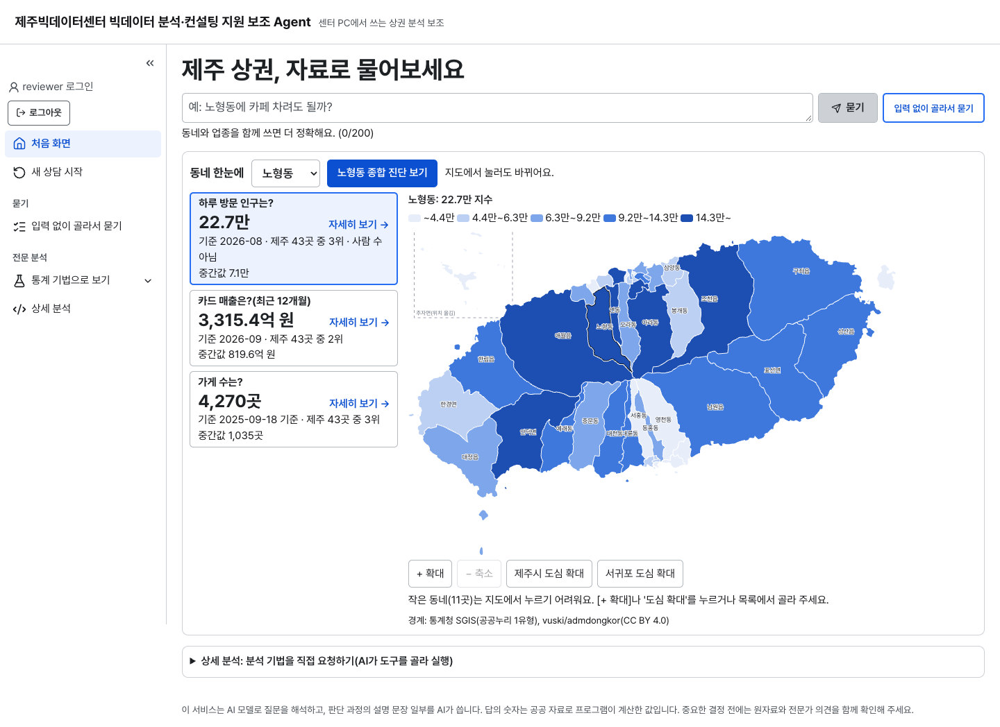
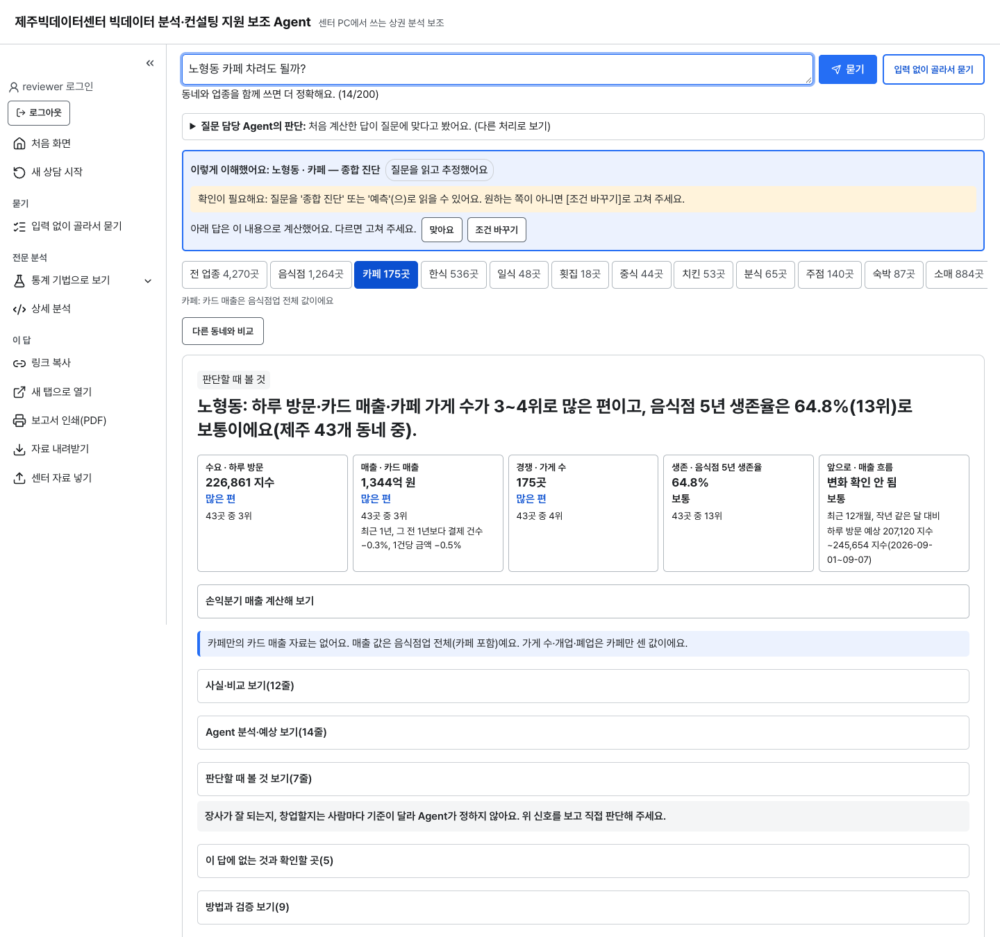
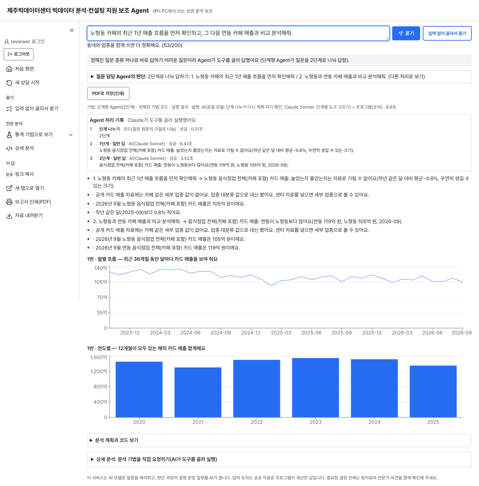
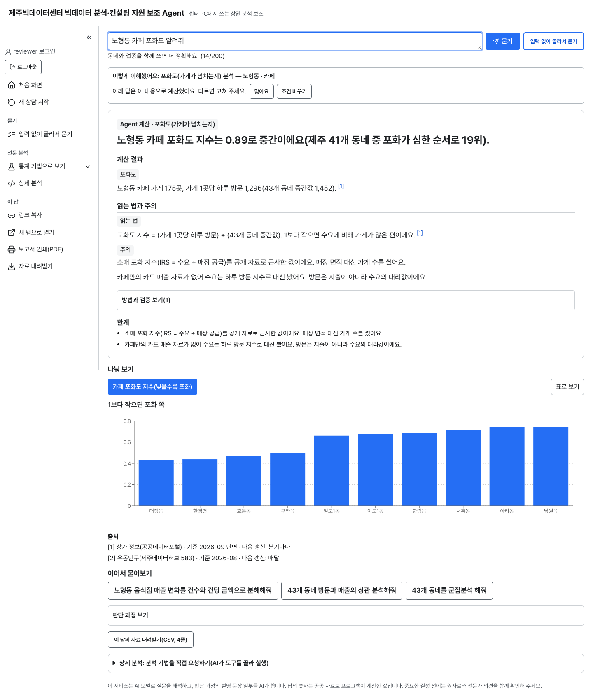
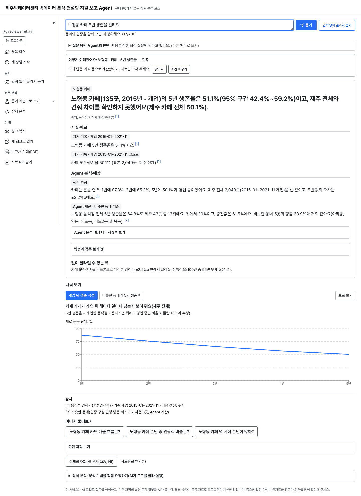

# 사용자 매뉴얼

센터를 찾은 도민(소상공인·예비창업자)과 센터 담당자가 화면을 쓰는 방법을 적는다. 설치와 실행은 `README.md` '빠른 실행'을 따른다. 화면은 2026-11-18 제출본(로컬 실행, 심사용 계정 로그인) 기준이다.

## 1. 화면 구성

| 위치 | 이름 | 하는 일 |
|---|---|---|
| 위 | 질문 칸·[묻기] | 평소 말로 질문한다. 200자까지 쓴다. 동네와 업종을 함께 쓰면 더 정확하다 |
| 위 | [입력 없이 골라서 묻기] | 주제·동네·업종을 차례로 골라 묻는다. 글을 쓰기 어려운 방문자에게 권한다 |
| 가운데 | 내 동네 | 동네를 고르면 하루 방문·카드 매출·가게 수 숫자 상자 3개와 43개 동네 중 순위가 바뀐다 |
| 가운데 | 지도 | 43개 동네의 하루 방문을 색으로 보여 준다. 동네를 누르면 그 동네가 선택된다 |
| 왼쪽 | 사이드바 | 로그인, 처음 화면, 새 상담 시작, 통계 기법으로 보기, 상세 분석, 링크 복사, 보고서 인쇄(PDF), 자료 내려받기. 답에 센터 자료 요청이 있으면 '센터 자료 넣기'가 나온다 |

## 2. 질문하고 답 읽기

1. 질문 칸에 질문을 쓰고 [묻기]를 누른다. 예: `노형동 카페 차려도 될까?`
2. 계산하는 동안 진행 단계가 표시된다. 보통 10초 안팎이고, 여러 단계 질문은 더 걸린다.
3. **이렇게 이해했어요**: Agent가 이해한 동네·업종·질문 종류를 확인한다. 맞으면 [맞아요], 다르면 [조건 바꾸기]로 고친다. '확인이 필요해요'가 붙은 칸은 Agent가 추정한 칸이다.
4. **결론 한 줄과 5칸 요약**: 수요(하루 방문)·매출(카드 매출)·경쟁(가게 수)·생존(5년 생존율)·앞으로(매출 흐름·방문 예상)를 43개 동네 중 순위와 함께 보여 준다.
5. **업종 탭**: 카페·한식·일식 등 업종을 눌러 같은 분석을 다시 실행한다. [다른 동네와 비교]로 비슷한 동네 5곳 중 하나와 11개 지표를 견준다.
6. **펼쳐 보기**: 사실·비교, Agent 분석·예상, 판단할 때 볼 것, 이 답에 없는 것과 확인할 곳, 방법과 검증을 눌러 펼친다. 줄 끝의 [번호]는 아래 '출처'의 자료 번호다.
7. 창업할지 말지는 Agent가 정하지 않는다. 답의 숫자와 한계를 보고 방문자가 판단하거나 센터 담당자와 상담한다.

## 3. 여러 가지를 한 번에 묻기

- 예: `노형동 카페의 최근 1년 매출 흐름을 먼저 확인하고, 그 다음 연동 카페 매출과 비교 분석해줘.`
- Agent가 질문을 단계로 나눠 답한다. 진행 표시에 '1/2단계'처럼 지금 단계가 나온다.
- **질문 담당 Agent의 판단**: 몇 단계로 나눴는지 보여 준다. 한 가지 질문이었다면 [다른 처리로 보기]에서 '한 가지 질문으로 보고 답하기'를 고른다.
- **Agent 처리 기록**: 단계마다 어떤 도구를 누가 골랐는지(로컬 모델 또는 Claude Sonnet) 보여 준다. 숫자는 모두 계산 코드가 냈다.
- [PDF로 저장(인쇄)]을 누르면 한눈에 → 단계별 결론·근거·그래프 → 알 수 있는 것과 없는 것 → 처리 과정 → 자료와 기준 시점 순서의 보고서가 만들어진다.

## 4. 통계 기법으로 보기

- 사이드바 '통계 기법으로 보기'에서 기법(상관·회귀·군집·시계열 분해·포화도 등 13종)을 고르거나, 질문 칸에 기법 이름을 쓴다. 예: `노형동 카페 포화도 알려줘`
- 포화도 지수 = (가게 1곳당 하루 방문) ÷ (43개 동네 중간값)이다. 0.8 미만이면 포화, 1.25 초과면 여유로 읽는다.
- 적용 조건(표본 수 등)이 맞지 않으면 계산하지 않고 이유를 보여 준다. '읽는 법과 주의'에 기법의 한계를 적는다.

## 5. 업종 생존율 보기

- 예: `노형동 카페 5년 생존율 알려줘`
- 5년 생존율은 2015-01~2021-11에 개업한 가게가 5년 뒤 영업 중인 비율이다(카플란-마이어). 95% 구간과 표본 수를 함께 보여 준다.
- 제주 전체와 통계로 차이가 확인될 때만 '높음·낮음'이라고 쓴다. 동네×업종 표본이 50곳 미만이면 순위에서 뺀다.

## 6. 보고서와 자료 받기
- **보고서 인쇄(PDF)**: 사이드바 또는 답 아래에서 누른다. 브라우저 인쇄 창에서 'PDF로 저장'을 고른다. 첫 쪽에 결론과 요약, 뒤쪽에 절별 내용과 부록(방법과 검증, 자료 목록과 기준 시점)이 들어간다.
- **자료 내려받기**: 답에 쓴 표를 CSV로 받는다.
- **링크 복사·새 탭으로 열기**: 같은 질문의 답을 다시 연다.

## 7. 센터 담당자 기능
| 기능 | 쓰는 법 |
|---|---|
| 로그인 | 사이드바 맨 위 [로그인] → 아이디·비밀번호. 로그인하면 여러 단계 질문의 단계별 도구 고르기에 Claude API를 쓰고, 상세 분석의 [Claude로 분석(담당자)]이 켜진다. 제출본은 API 보안을 위해 로그인 때만 Claude를 쓴다 |
| 상세 분석 | 사이드바 '상세 분석' → 분석을 문장으로 요청 → [분석 요청](로컬 모델이 기법 13종 중에서 골라 계산·해석). 목록에 없는 분석은 [Claude로 분석(담당자)]을 누른다. Claude가 쓴 코드는 검사한 뒤 분리된 프로세스에서 실행한다 |
| 센터 자료 넣기 | 답의 '자료 요청' 카드가 필요한 센터 자료와 조회 조건을 안내한다. 담당자가 센터 PC에서 조회한 CSV를 '센터 자료 넣기'로 넣으면 같은 질문을 그 자료로 다시 계산한다 |
| 보고서 검토 | 도민이 저장한 보고서 PDF를 면담 자료와 결과 초안으로 쓴다 |

## 8. 상담이 끝나면
- 사이드바 [새 상담 시작]을 누르거나 브라우저 창을 닫는다. 실행 스크립트가 연 창은 기록을 남기지 않는 창(Edge InPrivate 또는 Chrome 시크릿)이다.
- 다음 방문자가 오면 실행 스크립트를 다시 실행해 새 창을 연다(서버는 그대로 쓴다).

## 9. 자주 생기는 일
| 화면에 보이는 것 | 뜻과 할 일 |
|---|---|
| 답 위에 작게 'Agent 꺼짐' | 로컬 모델(`qwen2.5:7b`)이 없거나 Ollama가 꺼져 정해진 계산으로만 답했다. 실행 창의 안내대로 모델을 받고 앱을 다시 시작한다 |
| 이해한 내용이 질문과 다름 | [조건 바꾸기]로 동네·업종·질문 종류를 고친다 |
| '자료 범위 밖일 수 있는 말' | 임대료·시세·후기·제주 밖 지역·미래 매출 금액은 자료에 없다. 답에 없는 것과 확인할 곳을 본다 |
| '오래된 자료' 표시 | 자료의 기준 시점이 오래됐다. 출처의 '다음 갱신'과 센터 자료를 확인한다 |
| 첫 질문이 느림 | 첫 질문에서 모델을 메모리에 올린다. 두 번째 질문부터 빨라진다 |
| 차례를 기다리라는 안내 | 같은 PC에서 질문이 겹치면 하나씩 계산한다. 앞 질문이 끝나면 이어서 계산한다 |
